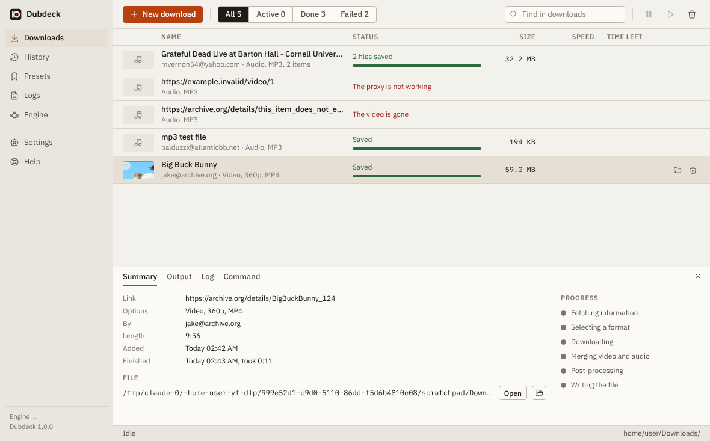

# Dubdeck

A desktop app for yt-dlp. Every command-line option, none of the command line.



Dubdeck wraps the yt-dlp engine in this repository with a native-feeling interface for Windows, macOS and Linux. Paste a link, see what it is, pick Video or Audio, press Download. When you need more, the Advanced tab has every option the engine has, each with a plain-English explanation and a live preview of the equivalent command.

- **For people using the app:** read the [user guide](docs/USER_GUIDE.md).
- **What maps to what:** [FEATURE_MATRIX.md](../FEATURE_MATRIX.md) lists all 323 engine flags and where each one lives in the app, with the result of testing it against the real engine.
- **What changed:** [CHANGELOG.md](CHANGELOG.md).

Version 1.0.0.

## Highlights

- Previews for every link: title, thumbnail, length, uploader, the formats on offer, and an item picker for playlists and channels.
- Simple mode with sensible defaults (MP4 that plays everywhere), and an Advanced mode generated from the engine's own option parser, so nothing the CLI can do is missing.
- A real queue: parallel downloads, live progress, speed and time left, pause, resume (also after quitting), cancel (cleans up partial files), retry, scheduling, and a searchable history.
- Failures explained in plain language: what happened, why, which step failed, what to try, and one-click fixes (update engine, retry with another format, choose another folder, use browser cookies, install ffmpeg). Unknown errors still get a friendly message, the full log and a redacted *Copy report*.
- Presets, config-file import and export, options applied to every download.
- Built-in updater for the app and a checksum-verified updater for the engine (stable, nightly, master, this fork, or any repository).
- ffmpeg and the engine ship inside the installers. The JavaScript runtime the engine needs for some sites is the app itself.
- Persistent logs with a Logs screen. Passwords, cookies, tokens, e-mail addresses and your user name are stripped before anything is written.

## Building

Requirements: Node.js 22 and Python 3.10 or newer. Installers have to be built on the system they are for (CI does all three, see `.github/workflows/desktop.yml`).

```sh
cd desktop
npm ci
npm start                 # run from source, using the yt-dlp source in this repo
npm run engine            # build the engine binary from this repo (PyInstaller) into vendor/engine
npm run ffmpeg            # download ffmpeg and ffprobe into vendor/ffmpeg
npm run dist              # installers for the current system, written to release/
```

`npm run dist` produces:

| System | Files |
|---|---|
| Windows | `Dubdeck-Setup-1.0.0-x64.exe` (installer), `Dubdeck-Portable-1.0.0-x64.exe` |
| macOS | `Dubdeck-1.0.0-mac-arm64.dmg` / `-x64.dmg`, plus `.zip` for the updater |
| Linux | `.AppImage` (portable), `.deb`, `.tar.gz` |

To publish a release that the built-in updater picks up, push a tag such as `desktop-v1.0.1`. The workflow builds everything and attaches it to a GitHub release on this repository.

Code signing is not set up. Unsigned builds work, but Windows SmartScreen and macOS Gatekeeper warn on first launch. Add certificates through the usual electron-builder environment variables (`CSC_LINK`, `CSC_KEY_PASSWORD`, `APPLE_ID`, …) when you have them.

## Testing

```sh
npm run typecheck
npm run test:unit         # option schema, command builder, config files, redaction, error translation
npm test                  # the above plus real downloads through the queue against a local server (needs ffmpeg)
npm run parity            # every one of the 323 flags through yt-dlp's real parser
npm run matrix            # parity, then regenerate FEATURE_MATRIX.md
```

When the engine gains or changes options, run `npm run gen` to re-read them. The unit tests then fail until each new option has a label and an explanation in `src/shared/meta.ts`, so new options are never shown unexplained.

## Layout

```
desktop/
  src/shared/      code used by both sides: option schema, command builder, error translation, redaction
    options.generated.json   dumped from yt_dlp/options.py by scripts/gen_options.py
    meta.ts                  hand-written names, explanations and categories for every option
    errors.ts                engine messages to plain explanations, stages and fixes
  src/main/        Electron main process: engine runner and updater, job queue, preview, logs, menus
  src/preload/     the bridge between the window and the main process
  src/renderer/    the interface (Preact), one file per screen in views/
  scripts/         option dump, icon set, engine build, ffmpeg fetch, parity test, matrix generator
  test/            unit and integration tests
  assets/          app icon (icon.svg is the source)
```

How a download runs: the window builds option values, `shared/command.ts` turns them into arguments in the parser's own order, and `main/jobs.ts` starts the engine with those arguments plus a few of its own (a machine-readable progress template, the bundled ffmpeg and JavaScript runtime). The app never adds a flag you have set yourself. Each output line is parsed into progress, stage changes, files and errors. On failure, `shared/errors.ts` turns the engine's message into an explanation.

## Design notes

One warm neutral palette with a single accent (tape-label orange), IBM Plex Sans and Plex Mono, a 4 px grid, Tabler icons at one stroke weight, and real light and dark themes that follow the system. Layout follows file managers and media tools: a sidebar, a toolbar, a dense table with columns and a detail pane. Native menus, context menus, file dialogs, shortcuts and window controls throughout.
