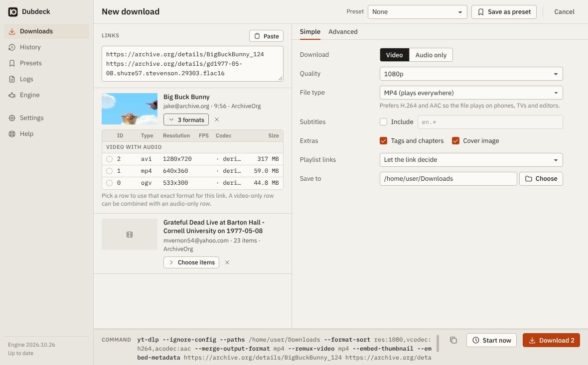
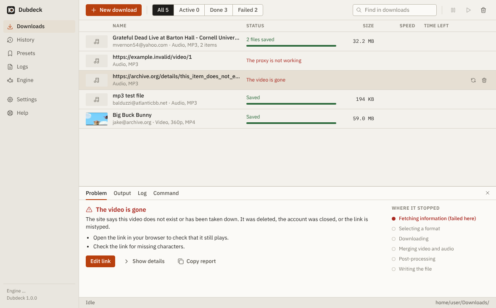

# Dubdeck user guide

Dubdeck saves video and audio from the web to your computer. You never need a terminal.

## Installing

- **Windows:** run `Dubdeck-Setup-1.0.0-x64.exe`. If Windows says it protected your PC, choose *More info*, then *Run anyway*. This happens because the app is not signed yet. Prefer not to install anything? `Dubdeck-Portable` runs from any folder, including a USB stick.
- **macOS:** open the `.dmg` and drag Dubdeck to Applications. The first time, right-click the app and choose *Open*, then *Open* again.
- **Linux:** make the `.AppImage` executable (file properties, "Allow executing as program") and double-click it. On Ubuntu or Debian, the `.deb` installs it like any other app.

Everything Dubdeck needs is inside. There is nothing else to install.

## Your first download

1. Copy the address of a video from your browser.
2. In Dubdeck, choose **New download** (or press Ctrl+N, ⌘N on a Mac) and paste the address. You can paste several, one per line. Dropping a link onto the window also works.
3. After a moment you see the title, length and a picture. For a playlist or channel, **Choose items** lets you untick the ones you don't want.
4. On the right, choose **Video** or **Audio only**, a quality and a file type. If you are not sure, leave the defaults: you get an MP4 that plays everywhere.
5. Press **Download**.

The download appears in the list with its progress. When it finishes, double-click it to open the file, or use the folder button to see it in its folder.

## Common tasks

**Just the audio, as MP3:** choose *Audio only* and *MP3*. Or pick the built-in *Podcast MP3* preset at the top.

**A whole playlist or channel:** paste its address. To be sure you get every video, set *Playlist links* to *Always take the whole playlist*.

**Only new videos from a channel, each time:** use the built-in *Channel archive* preset. It remembers what it has downloaded and skips those next time.

**Subtitles:** tick *Include* next to Subtitles and type the languages, for example `en.*,de`.

**Start later:** press **Start now** next to the Download button and choose a time. Dubdeck needs to be open then.

**Save your choices:** press **Save as preset**. Next time, choose it from the *Preset* list.

**Change where files go:** *Save to* on the New download screen, or Settings for the default.

## Pausing, cancelling and quitting

- **Pause** keeps what has already downloaded. **Resume** carries on from there.
- If you quit while something is downloading, Dubdeck asks first. Unfinished downloads pick up again the next time you open the app.
- **Cancel** stops a download and deletes the unfinished file.
- Right-click any row for more: open, show in folder, copy link, edit options, copy a problem report.

## When something goes wrong

Select the row that failed. Dubdeck says in plain words what happened, why it probably happened, which step it stopped at, and what to try.

Often there is a button that fixes it for you:

| You see | What it means | The button |
|---|---|---|
| The site has changed | The site was updated and the engine needs to catch up | **Update engine and retry** |
| You need to be signed in, age-restricted, private, members only | The site wants to know who you are | **Use browser cookies**. Sign in to the site in your browser first |
| Not available in your region | The site blocks your country | Set a proxy or VPN under Advanced, Network |
| That quality or format is not offered | The video does not come in what you picked | **Retry with best available format** |
| The disk is full, not allowed to write there | The folder cannot take the file | **Choose another folder** |
| ffmpeg is missing | A converting tool is missing | **Install ffmpeg** |
| No internet connection, connection kept dropping | Network trouble | **Try again**. Downloads resume where they stopped |

If none of that helps, **Update engine and retry** is always worth a try: most surprises are fixed in a newer engine. To ask someone for help, press **Copy report** and paste it into your message. Passwords, cookies and your user name are removed from it automatically.

## Advanced options

The **Advanced** tab lists everything the yt-dlp engine can do: around 200 settings in groups such as *Format and quality*, *Sign-in and cookies*, *SponsorBlock* and *Conversion*.

- Use the search box to find an option by name.
- Point at an option to read what it does. Click its name to keep the explanation open.
- Changed options get an orange dot. The arrow on the right puts one back.
- Advanced choices win over Simple ones, and the Simple tab tells you when that happens.
- The *Command* bar at the bottom shows what Dubdeck will run, for the curious. You never need to type it.

Settings for every download (a proxy, a speed limit, a cookies browser) go in Settings, under *Options for every download*.

Already have a yt-dlp config file? **Presets › Import config file** turns it into a preset.

## Keeping up to date

- Dubdeck checks for a newer engine when it starts and says so at the bottom of the sidebar. The **Engine** screen updates it in one click. If a fix is not out yet, switch *Update from* to *Nightly builds*.
- New versions of Dubdeck itself download in the background. Settings shows a *Restart to update* button when one is ready.

## Keyboard shortcuts

| Keys | Does |
|---|---|
| Ctrl+N | New download |
| Ctrl+V (outside a text box) | Paste links and open New download |
| Ctrl+Enter | Start the download |
| Ctrl+1 … 5 | Downloads, History, Presets, Logs, Engine |
| Ctrl+, | Settings |
| Ctrl+F | Search the current list |
| Space | Pause or resume the selected downloads |
| Delete | Cancel or remove the selected downloads |
| F1 | Help |

On a Mac, use ⌘ instead of Ctrl.

## Privacy

Dubdeck talks only to the sites you download from, to GitHub to check for updates, and to SponsorBlock if you turn it on. Logs stay on your computer. Nothing is sent anywhere unless you copy a report and share it yourself.

Please download only what you have the right to, and respect the terms of the sites you use.
